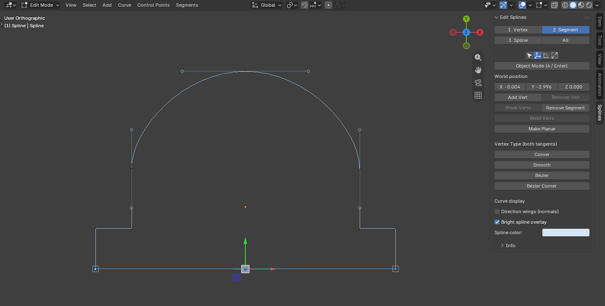
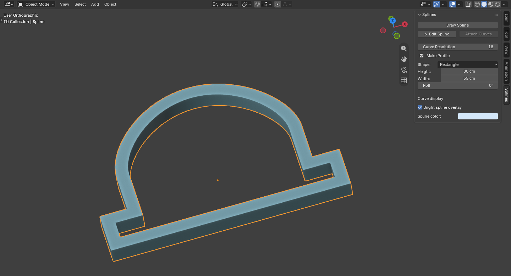

# Splines for Blender

Splines is a Blender extension for drawing and editing native Bézier curves in the 3D Viewport. Draw mixed straight and curved outlines directly, then work at the vertex, segment, spline, or whole-curve level.

**Development build 0.26.4** · Maintained by **Pease Technology, LLC** · Tested on Blender 5.2.4 LTS for Windows with the Default and Industry Compatible keymaps.

## Quick start

1. Build the ZIP from this checkout. In Blender, go to **Edit → Preferences → Get Extensions** and choose **Install from Disk** from the top-right menu. [Build instructions](docs/BUILD.md#build-and-validate)
2. In Object Mode, choose **Add → Curve → Draw Spline** or open the **Splines** tab in the viewport sidebar with **N** (Default) or **Ctrl+]** (Industry Compatible). Click to place corners or drag to pull linked handles. Right-click to finish an open spline. Click the first point to close it after placing at least three vertices.
3. Select a Bézier curve and press **6** to edit. Use **1–3** or the **All** sidebar button for the selection level and **Q/W/E/R** for Select, Move, Rotate, or Scale. Press **4** or **Enter** to return to Object Mode.

## Features

- View-aligned drawing at the 3D cursor's depth, with first-point grid snapping, 45° direction constraints, and click-drag Bézier closure.
- Direct handle editing, a right-click vertex-type menu, and separate selection levels for vertices, segments, splines, and all geometry.
- Move, Rotate, and Scale gizmos with world-axis constraints, Shift snapping, and editable world coordinates in the sidebar.
- Insert, remove, break, and weld vertices, or attach, detach, and flatten splines.
- Sweep a live rectangle or circle along a spline. Adjust curve resolution, rectangle width, height and roll, or circle radius.
- When the viewport sidebar is open, selecting a Bézier curve shows **Splines**. Selecting or adding a mesh from there returns to Blender’s **Item** tab.
- Native Undo/Redo for completed gestures and native Bézier geometry that remains editable after saving and reopening the project.

## Compatibility and scope

Splines editing operates on one editable all-Bézier curve object at a time. That object can contain multiple splines. The custom gizmos edit the source geometry in Curve Edit Mode. Use Blender Object Mode to transform the object and its origin.

The current package is for local testing. Public extension distribution awaits a license decision.

- [User guide](docs/USER_GUIDE.md) for controls, working examples, and known limits
- [Build and test instructions](docs/BUILD.md) for packaging and verification
- [Test results](docs/TEST_PLAN.md)
- [1.0 release preparation and roadmap](docs/ROADMAP.md#10-release-preparation)
