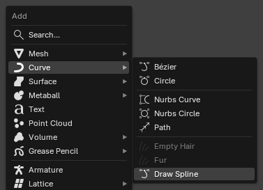
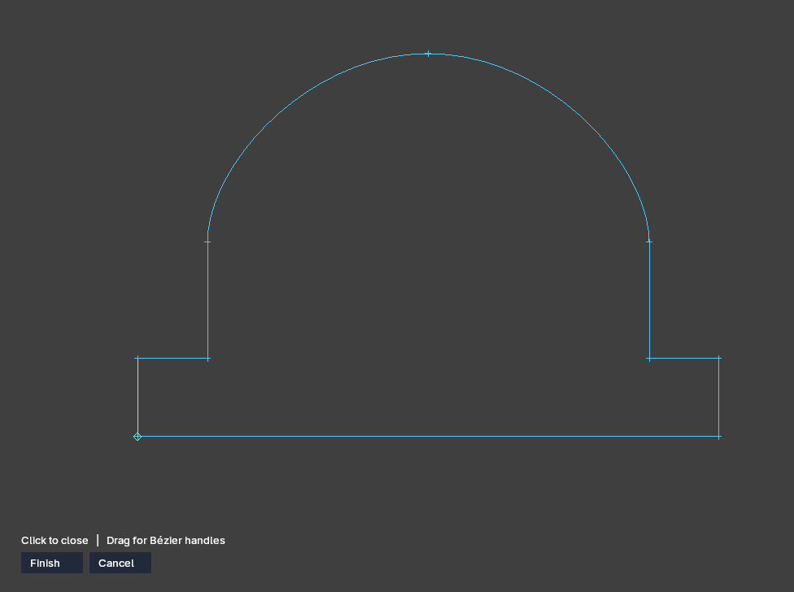

# Splines user guide

This guide covers Splines 0.26.4, tested on Blender 5.2.4 LTS for Windows. The ZIP installs as **Splines** and uses the extension ID `spline_maker`.

## Install or update

Build `dist/spline_maker-0.26.4.zip` from the repository. [Build instructions](BUILD.md#build-and-validate)

In Blender, open **Edit → Preferences → Get Extensions**. From the top-right menu, choose **Install from Disk** and select the ZIP. Enable **Splines** under **Add-ons** if needed. When replacing a previous build, disable it and restart Blender before installing. If Blender reports an already-registered class, restart and check the version under **Add-ons** before enabling it again.

## Draw an outline

1. In Object Mode, orient the viewport and put the 3D cursor at the desired drawing depth. Choose **Add → Curve → Draw Spline**, marked with a Bézier icon, or use **Draw Spline** in the **Splines** sidebar tab. Open the sidebar with **N** in the Default keymap or **Ctrl+]** in Industry Compatible. The starting view fixes the drawing plane for that spline.
2. Click for a corner or click-drag to make a vertex with linked tangent handles. Hold **Shift** on the first point to snap to the drawing-plane grid. Hold it on later points for 45° direction steps.
3. Press **Backspace** or **Ctrl+Z** to remove the last preview point. Right-click or press **Enter** after at least two vertices to finish an open spline. To close a spline with three or more vertices, click its first point. Click-drag from that first point to set linked handles at the seam.
4. Press **Esc** or click **Cancel** to discard the drawing. Once the spline is finished, Blender Undo removes the created curve object in one step.

You can orbit, pan, or zoom during drawing. Click placement works best when you can see the drawing plane. In an edge-on view, rotate the viewport back toward that plane before placing another point.

## Select and edit

Select an editable Bézier curve in Object Mode and press **6** or use **Edit Spline** in the **Splines** sidebar. **6** enters Vertex mode with **Q Select** active. With a single curve selected, **1**, **2**, and **3** can enter the corresponding level directly. In Curve Edit Mode, **Q** also enters Splines Select from a native tool. The level buttons and tool icons in **Edit Splines** provide the same actions.

With the viewport sidebar open, selecting the curve switches it to **Splines**. Selecting or adding a mesh from the **Splines** tab switches it back to Blender’s **Item** tab.

| Key | Level | Behavior |
| --- | --- | --- |
| **1** | Vertex | Select individual anchors and handles. |
| **2** | Segment | Select spans between anchors. Box selection includes any segment the box touches. |
| **3** | Spline | Select an individual open or closed spline. A single-spline object selects its spline automatically when all vertices are visible. A box must enclose the spline. |
| Sidebar **All** | All | Select all source splines in the active curve object, including hidden points. |

Use **Shift-click** to toggle selection or **Shift-drag** a selection box to add to the selection. Small squares mark anchors and diamonds mark handles. Drag a handle's diamond directly in any Splines edit tool. Right-click while idle to choose **Corner** (straight tangents), **Smooth** (automatic tangents), **Bézier** (linked manual tangents), or **Bézier Corner** (independent tangents).

| Key | Tool | Behavior |
| --- | --- | --- |
| **Q** | Select | Pick components and hide transform gizmos. |
| **W** | Move | Drag a world axis, a plane square, or the view-plane center. |
| **E** | Rotate | Drag an axis ring or the view-facing ring. In Vertex mode choose **Tangents** or **Group** in the sidebar. |
| **R** | Scale | Drag an axis box or the uniform center. At Segment, Spline, and All levels, the offset XY box scales world X and Y together with Z fixed. |

Segment, Spline, and All transforms pivot around the average of the unique selected anchors. Vertex Move also uses the selected anchors' average. Vertex Rotate in **Tangents** mode and Vertex Scale work around each anchor. **Group** rotation rotates the selected anchors and their handles together.

Hold **Shift** while rotating to snap in 10° steps with additional 45° stops. Hold it while scaling for 1% steps. For a single vertex Move, Shift can align with a nearby vertex along the eligible world X or Y direction. For a direct handle drag, Shift can align to the spline's X/Y directions or the adjoining segment line. Expand **Info** in the sidebar for the relevant hints. To set an exact position, select geometry and click an axis under **World position**.

With Industry Compatible, you can hold a gizmo drag and use the wheel to zoom or **Alt+middle-mouse** to pan. In the Default keymap, **middle-mouse** orbit was checked during Move. The preview holds its current shape while you navigate. Release the drag to commit it. **Esc** or an unmodified right-click cancels the active gesture. **4**, **Enter**, and **Numpad Enter** return to Object Mode from Curve Edit Mode. **Esc** exits when a Splines editing tool is active and idle.

## Change spline topology

- Click **Add Vert**, then pick where to insert a vertex on the curve. **Remove Vert** and **Remove Segment** act on the matching selection level, as does **Delete**. **Break Verts** splits an interior vertex into separate endpoints.
- In Object Mode, select editable Bézier curve objects, make the destination active, then click **Attach Curves**. Their paths stay in place inside one curve object. In **3 Spline**, select paths and click **Detach** to move them into a separate object. Leave at least one path on the original.
- To join two open endpoints, select them in **1 Vertex** on the same curve object and click **Weld Verts**. The join is placed at their midpoint. You can also weld the open ends of a single path to close it.
- Click **Make Planar** to project the selected anchors and handles onto the recorded drawing plane or a plane facing the current view.

## Make a profile

Select a Bézier curve in Object Mode and enable **Make Profile** in the **Splines** sidebar. Start with **Rectangle** and set **Height**, **Width**, and **Roll**, or choose **Circle** and set **Radius**. **Curve Resolution** controls the number of samples on curved spans. The file remembers the last Rectangle height and width you enter for newly enabled profiles. On an older profile, **Update Profile Corners** applies the current corner handling.

## Save and reopen

Save the `.blend` normally. Committed anchors, handles, and closure are native Blender curve data. Saving cancels a pending preview. On reopen, Splines session controls return to their defaults and an open viewport using a Splines tool switches to native Select Box. Select the curve and press **6** to resume.

## Known limits

- Custom editing supports one editable all-Bézier curve object at a time. Use Blender's native tools for other curve types or multi-object editing.
- If a world axis faces the viewport or an active plane is edge-on, orbit to make the control usable.
- If a spline is partially hidden, unhide its vertices before using **3 Spline**. For overlapping or ambiguous closed interiors, pick a visible boundary.
- Weld requires two open endpoints. Branching welds and profile intersections remain future work.
- Profile sweeps can overlap where the centerline doubles back or crosses itself.
- Compatibility outside Blender 5.2.4 LTS on Windows is unverified. [Test results](TEST_PLAN.md)
